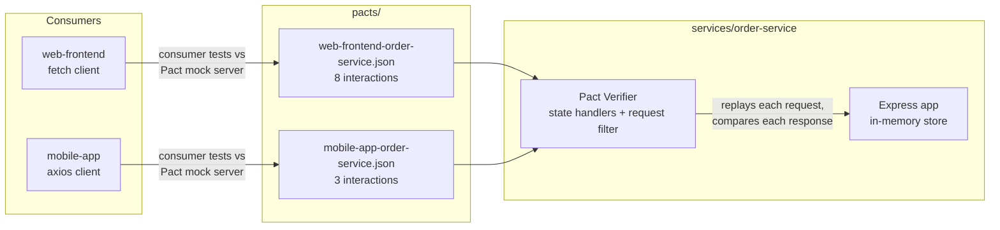
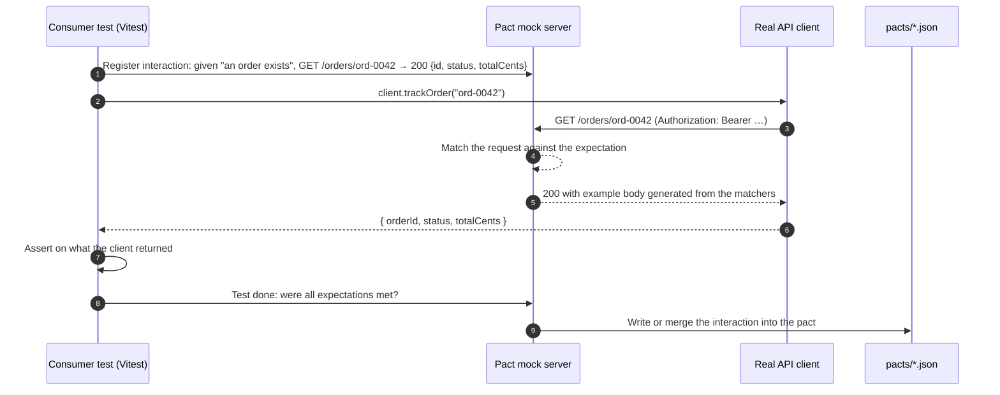
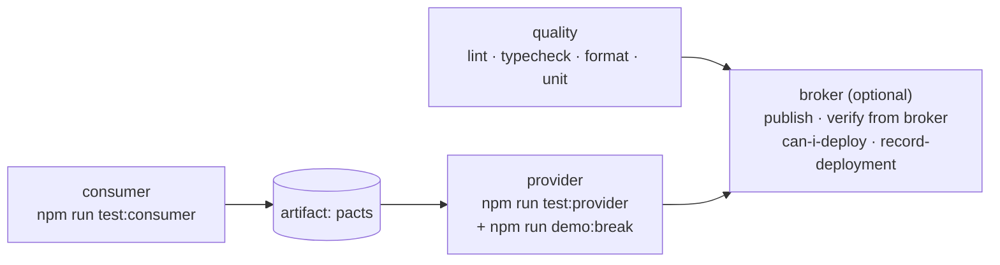
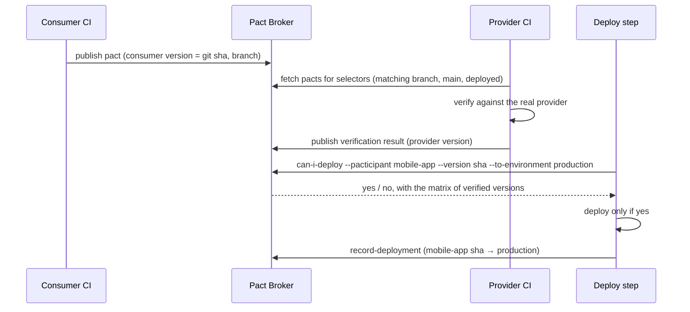

# pact-contract-testing-demo

[](https://github.com/fathirwafda/pact-contract-testing-demo/actions/workflows/contracts.yml)


A small, complete example of **consumer-driven contract testing** with [Pact](https://docs.pact.io):
one provider (an order service for a fictional shop) and two consumers (a web storefront and a
mobile app) that need different parts of the same API. Each consumer's tests run its real API
client against a Pact mock server and record a contract. The provider then replays every contract
against the real running service. A scripted breaking change shows the contract catching a
regression that only one of the two consumers would have noticed.

Everything runs locally from a fresh clone with no Docker and no network services. The Pact Broker
part is optional and documented separately.

## Contents

- [What contract testing is for](#what-contract-testing-is-for)
- [How it fits together](#how-it-fits-together)
- [The two consumers need different things](#the-two-consumers-need-different-things)
- [Project structure](#project-structure)
- [Quick start](#quick-start)
- [Breaking-change demo](#breaking-change-demo)
- [What the tests cover](#what-the-tests-cover)
- [CI pipeline](#ci-pipeline)
- [Optional: Pact Broker and can-i-deploy](#optional-pact-broker-and-can-i-deploy)
- [Configuration](#configuration)
- [Design decisions](#design-decisions)
- [Limitations](#limitations)
- [Roadmap](#roadmap)
- [License](#license)

## What contract testing is for

When services talk over HTTP, a common way to break production is a change that is correct
inside one service and wrong for its callers: a renamed field, a stricter validation rule, a
different status code. Unit tests on either side cannot see this, because each side tests against
its own assumptions about the other.

A **consumer-driven contract** turns those assumptions into a file. The consumer's tests describe
the requests it makes and the minimum it needs from each response, and Pact records that as a
_pact_. The provider's build replays the pact against the real service. If the provider stops
meeting any consumer's expectations, the provider's build fails, before deployment, with the name
of the consumer and the exact field.

**Contract tests vs end-to-end tests**

|                     | Contract tests (this repo)                       | End-to-end tests                            |
| ------------------- | ------------------------------------------------ | ------------------------------------------- |
| Question answered   | Do these two services agree on the API?          | Does the whole user journey work?           |
| Needs               | One service at a time, in-process                | All services deployed together, with data   |
| Speed and flakiness | Seconds, deterministic                           | Minutes, sensitive to environments and data |
| Failure message     | `mobile-app` needs `$.items[0].stock`            | "checkout page did not load"                |
| Finds business bugs | No: a contract says nothing about correct prices | Yes                                         |
| Good fit            | Many teams and services, independent deployments | A few critical journeys, release confidence |

They complement each other. Contracts take over the job of "are the integrations still wired
correctly", so the E2E suite can stay small and focus on journeys.

## How it fits together



A consumer test drives the **real client code** against the mock server. Pact only writes the
interaction to the pact file if the client sent exactly the request that was declared and the test
passed with the declared response:



On the provider side, the verifier reads each interaction, calls the state handler for its
`given(...)` state (which seeds the in-memory store), passes the request through a request filter
(which swaps the recorded test token for one the provider accepts) and compares the real response
with the matchers in the pact.

## The two consumers need different things

This is the core of the demo. Both consumers call the same endpoints, but each one only declares
the fields it actually reads. The provider sends more than either of them needs.

| Response field                           | Provider sends | `web-frontend` relies on | `mobile-app` relies on |
| ---------------------------------------- | :------------: | :----------------------: | :--------------------: |
| `product.id`                             |      yes       |           yes            |          yes           |
| `product.name`                           |      yes       |           yes            |          yes           |
| `product.priceCents`                     |      yes       |           yes            |          yes           |
| `product.description`                    |      yes       |           yes            |           -            |
| `product.currency`                       |      yes       |           yes            |           -            |
| `product.imageUrl`                       |      yes       |           yes            |           -            |
| `product.stock`                          |      yes       |            -             |    yes ("Sold out")    |
| `product.sku`                            |      yes       |            -             |           -            |
| `product.category`                       |      yes       |            -             |           -            |
| `product.createdAt`                      |      yes       |            -             |           -            |
| `order.id`, `status`, `totalCents`       |      yes       |           yes            |          yes           |
| `order.items[]`, `currency`, `createdAt` |      yes       |           yes            |           -            |

What this tells the provider team, from the contracts alone:

- Renaming `stock` breaks **only** `mobile-app`. The web team would never notice in their own tests.
- `sku`, `category` and `createdAt` on products are read by no current consumer, so they can be
  changed or removed without breaking anyone (the contracts would still pass).
- `GET /products?category=…` and the 401 behaviour of `GET /orders/:id` are used by `mobile-app`;
  `POST /orders` and its 400 validation shape are used by `web-frontend`.

A shared OpenAPI schema could not tell you any of this: it describes what the provider offers, not
what each consumer depends on.

## Project structure

```
.
├── services/order-service/        # Provider
│   ├── src/
│   │   ├── app.ts                 # Express routes, auth, validation (zod), error shape
│   │   ├── config.ts              # Env parsing, including the breaking-change flag
│   │   ├── domain.ts              # Product, Order, error types
│   │   ├── server.ts              # `npm run start:provider`
│   │   └── store.ts               # In-memory store and sample catalogue
│   └── test/
│       ├── app.test.ts            # Unit/behaviour tests of the handlers
│       └── provider.verify.test.ts# Pact verification: states, request filter, pact source
├── consumers/
│   ├── pact-config.ts             # Shared PactV4 setup (names, pact dir, log level)
│   ├── web-frontend/
│   │   ├── src/order-service-client.ts   # fetch client, web's own types
│   │   └── test/order-service.pact.test.ts
│   └── mobile-app/
│       ├── src/order-service-client.ts   # axios client, mobile's own types
│       └── test/order-service.pact.test.ts
├── scripts/demo-break.ts          # `npm run demo:break`
├── pacts/                         # Generated, git-ignored
├── docker-compose.broker.yml      # Optional local Pact Broker + Postgres
├── .github/workflows/contracts.yml
├── vitest.config.ts               # Projects: unit, consumer, provider
└── eslint.config.mjs, tsconfig.json, .prettierrc.json, .nvmrc
```

It is one npm package with folders per service rather than npm workspaces: there is nothing to
publish or build separately, and one lockfile keeps the setup small. In a real system the consumers
and the provider would live in separate repositories and exchange pacts through a broker.

## Quick start

Requirements: Node.js 22 or newer (`.nvmrc` pins 22; `@pact-foundation/pact` 17 requires it). On
install, npm pulls the Pact core native library for your platform as an optional dependency.

```bash
nvm use
npm install

npm run test:consumer   # runs both consumers' Pact tests and writes pacts/*.json
npm run test:provider   # starts the provider in-process and verifies every pact in pacts/
npm run test            # unit tests + consumer tests + provider verification

npm run demo:break      # shows the contracts catching a breaking change (see below)
```

Quality checks:

```bash
npm run lint
npm run typecheck
npm run format:check
npm run test:unit
```

To run the provider on its own: `npm run start:provider`, then for example
`curl -H 'Authorization: Bearer local-dev-token' localhost:3000/orders/ord-0001`.

## Breaking-change demo

The provider has a deliberate, opt-in regression behind `ORDER_SERVICE_BREAKING_CHANGE=rename-stock`:
product responses send `quantityAvailable` instead of `stock`. It is the kind of rename that looks
harmless in a code review. `npm run demo:break` runs provider verification with that flag set only
for the child process, prints the Pact failure, and exits 0 when the contract caught the change.
Nothing in the code or the pacts is modified, so the next normal run passes again.

Output from a local run:

```text
Verifying the provider with ORDER_SERVICE_BREAKING_CHANGE=rename-stock
(the provider renames `stock` to `quantityAvailable` in product responses)

Consumers verified: mobile-app, web-frontend

Failures:

1) Verifying a pact between mobile-app and order-service Given products exist in a category - a request for product tiles in a category
    1.1) has a matching body
           $.items[0] -> Actual map is missing the following keys: stock


There were 1 pact failures

Result: the contract caught the breaking change, as expected.
Only mobile-app reads `stock`, so only its contract fails; web-frontend is unaffected.
The provider code is unchanged. Run `npm run test:provider` to see it pass again.
```

What to notice:

- **One failure, not eleven.** The 8 `web-frontend` interactions and the other 2 `mobile-app`
  interactions still pass. The failure names the consumer, the provider state, the interaction and
  the JSON path.
- **The extra field did not matter.** The response also gained `quantityAvailable`; Pact ignores
  fields no consumer asked for. Only the missing one fails.
- **It runs in CI too.** The provider job runs `demo:break` after the real verification, so if a
  future change made the contracts too loose to catch this, CI would fail.

To see the raw verifier output instead of the summary:
`ORDER_SERVICE_BREAKING_CHANGE=rename-stock npm run test:provider` (exits 1).

## What the tests cover

| Suite                                          | Runner + tool               | Count (local run)                |
| ---------------------------------------------- | --------------------------- | -------------------------------- |
| Provider unit/behaviour (`app.test.ts`)        | Vitest, real HTTP on port 0 | 25 tests                         |
| `web-frontend` consumer (`*.pact.test.ts`)     | Vitest + `PactV4`           | 8 tests, 8 interactions          |
| `mobile-app` consumer (`*.pact.test.ts`)       | Vitest + `PactV4`           | 3 tests, 3 interactions          |
| Provider verification (`provider.verify.test`) | Vitest + Pact `Verifier`    | 1 test, verifies 11 interactions |

Contract interactions, by status code:

| Consumer     | Interaction                            | Provider state               | Status |
| ------------ | -------------------------------------- | ---------------------------- | :----: |
| web-frontend | `GET /products`                        | products exist               |  200   |
| web-frontend | `GET /products/prd-1001`               | a product exists             |  200   |
| web-frontend | `GET /products/prd-9999`               | no product exists            |  404   |
| web-frontend | `POST /orders`                         | a product is in stock        |  201   |
| web-frontend | `POST /orders` with `items: []`        | (none)                       |  400   |
| web-frontend | `POST /orders` without a token         | (none)                       |  401   |
| web-frontend | `GET /orders/ord-0042`                 | an order exists              |  200   |
| web-frontend | `GET /orders/ord-9999`                 | no order exists              |  404   |
| mobile-app   | `GET /products?category=kitchen`       | products exist in a category |  200   |
| mobile-app   | `GET /orders/ord-0042`                 | an order exists              |  200   |
| mobile-app   | `GET /orders/ord-0042` without a token | an order exists              |  401   |

Provider states carry parameters (for example `{ "productId": "prd-1001", "stock": 10 }`), so the
state handler seeds exactly what the interaction needs. The unit tests cover what the contracts
deliberately do not: 409 out-of-stock, stock decrements, malformed JSON, ownership checks (another
customer's order is a 404), and config parsing.

An excerpt of the generated `mobile-app` pact, showing that it pins types and patterns, not values:

```json
"$.items":            { "matchers": [{ "match": "type", "min": 1 }] },
"$.items[*].id":      { "matchers": [{ "match": "regex", "regex": "^prd-\\d+$" }] },
"$.items[*].name":    { "matchers": [{ "match": "type" }] },
"$.items[*].priceCents": { "matchers": [{ "match": "integer" }] },
"$.items[*].stock":   { "matchers": [{ "match": "integer" }] }
```

## CI pipeline

`.github/workflows/contracts.yml` runs on pushes to `main`, pull requests and manual dispatch.



- `consumer` uploads `pacts/*.json` as an artifact; `provider` downloads it and verifies, so the
  provider job tests exactly the contracts produced in the same run.
- The `broker` job only runs when the repository variable `PACT_BROKER_BASE_URL` is set
  (`if: vars.PACT_BROKER_BASE_URL != ''`). Without a broker the pipeline is complete and green.
- Actions are pinned to major versions (`actions/checkout@v4`, `setup-node@v4`,
  `upload-artifact@v4`, `download-artifact@v4`), and Node comes from `.nvmrc`.

## Optional: Pact Broker and can-i-deploy

Passing pact files around as CI artifacts works when the consumers and the provider build
together. Once they live in separate repositories and deploy independently, a
[Pact Broker](https://docs.pact.io/pact_broker) stores every pact and verification result by
version and branch, and answers "can I deploy version X of this app to production?".



Run a broker locally (requires Docker):

```bash
npm run broker:up                                 # pact-broker + postgres on http://localhost:9292
export PACT_BROKER_BASE_URL=http://localhost:9292
export GIT_COMMIT=$(git rev-parse HEAD) GIT_BRANCH=$(git branch --show-current)
export DEPLOY_ENVIRONMENT=production              # the self-hosted broker creates "production" itself

npm run test:consumer && npm run pact:publish
PACT_PUBLISH_VERIFICATION_RESULTS=true npm run test:provider   # pulls pacts from the broker

# Provider first: consumers can only deploy next to a recorded, verified provider version.
for app in order-service web-frontend mobile-app; do
  PACTICIPANT=$app npm run pact:can-i-deploy && PACTICIPANT=$app npm run pact:record-deployment
done
npm run broker:down                               # also deletes the broker's volume
```

`npm run pact:create-environment` is only needed on a broker that has no environment of that name
yet (for example a new hosted broker). The local image already has `production` and rejects a
duplicate.

### What a local broker run showed

This sequence was run once against `docker-compose.broker.yml`, with `GIT_BRANCH=main` and
made-up versions (the folder was not a git repository at the time). Publishing created both
consumer versions. Verification pulled both pacts from the broker, and its first notice said they
were _pending_ because no `main` verification existed yet. It then published successful results.

`can-i-deploy` for `mobile-app` version `0a1b2c3`, after `order-service` `0a1b2c3` was verified
and recorded as deployed to production:

```text
┌────────────┬───────────┬───────────────┬───────────┬──────────┬────────┐
│ CONSUMER   ┆ C.VERSION ┆ PROVIDER      ┆ P.VERSION ┆ SUCCESS? ┆ RESULT │
╞════════════╪═══════════╪═══════════════╪═══════════╪══════════╪════════╡
│ mobile-app ┆ 0a1b2c3   ┆ order-service ┆ 0a1b2c3   ┆ true     ┆ 1      │
└────────────┴───────────┴───────────────┴───────────┴──────────┴────────┘

VERIFICATION RESULTS
--------------------
1. http://localhost:9292/pacts/provider/order-service/consumer/mobile-app/pact-version/d0ee9d3a685330495f553226cd4b807c3c754aae/metadata/Y3ZuPTBhMWIyYzM/verification-results/200 (success)


All required verification results are published and successful


✅ Computer says yes \o/
```

Then a provider version `0a1b2c4` was verified with `ORDER_SERVICE_BREAKING_CHANGE=rename-stock`
and its (failed) results published. `can-i-deploy` for that provider version:

```text
┌──────────────┬───────────┬───────────────┬───────────┬──────────┬────────┐
│ CONSUMER     ┆ C.VERSION ┆ PROVIDER      ┆ P.VERSION ┆ SUCCESS? ┆ RESULT │
╞══════════════╪═══════════╪═══════════════╪═══════════╪══════════╪════════╡
│ mobile-app   ┆ 0a1b2c3   ┆ order-service ┆ 0a1b2c4   ┆ false    ┆ 1      │
├╌╌╌╌╌╌╌╌╌╌╌╌╌╌┼╌╌╌╌╌╌╌╌╌╌╌┼╌╌╌╌╌╌╌╌╌╌╌╌╌╌╌┼╌╌╌╌╌╌╌╌╌╌╌┼╌╌╌╌╌╌╌╌╌╌┼╌╌╌╌╌╌╌╌┤
│ web-frontend ┆ 0a1b2c3   ┆ order-service ┆ 0a1b2c4   ┆ true     ┆ 1      │
└──────────────┴───────────┴───────────────┴───────────┴──────────┴────────┘

The verification for the pact between the version of mobile-app currently in production (0a1b2c3) and version 0a1b2c4 of order-service failed


❌ Computer says no ¯\_(ツ)_/¯
❌ No deployable version found
```

The broker blocks the provider deploy, names the consumer version in production that would break,
and confirms the web storefront would have been fine.

Two things the run taught, both now reflected above:

- Run `can-i-deploy` for the provider first. Before any provider version was recorded in
  production, the consumers' checks failed with "no version is currently recorded as
  deployed/released in this environment".
- Pact's `Verifier` rejects broker credential options that are present but `undefined`
  (`TypeError: pactBrokerToken`), so the verification test only passes the credentials that are
  set.

When `PACT_BROKER_BASE_URL` is set, provider verification fetches pacts from the broker (consumer
version selectors: matching branch, main branch, deployed or released; pending pacts enabled)
instead of reading `pacts/`. The npm scripts use the `pact broker` command from
`@pact-foundation/pact-cli`. To enable the CI job, set the repository variable
`PACT_BROKER_BASE_URL` (and optionally `PACT_DEPLOY_ENVIRONMENT`), plus `PACT_BROKER_TOKEN` or
`PACT_BROKER_USERNAME`/`PACT_BROKER_PASSWORD` as secrets.

## Configuration

No env file is used. Every variable has a default, or is only needed for the optional broker flow.

| Variable                            | Used by                                       | Default                   | Purpose                                                                                         |
| ----------------------------------- | --------------------------------------------- | ------------------------- | ----------------------------------------------------------------------------------------------- |
| `PORT`                              | `start:provider`                              | `3000`                    | Port for the standalone provider.                                                               |
| `ORDER_SERVICE_API_TOKENS`          | `start:provider`                              | `local-dev-token:cus-001` | Accepted bearer tokens as `token:customerId,token:customerId`. Verification uses its own token. |
| `ORDER_SERVICE_BREAKING_CHANGE`     | provider, `demo:break`                        | `none`                    | `rename-stock` sends `quantityAvailable` instead of `stock`. Demo only.                         |
| `PACT_LOG_LEVEL`                    | consumer tests, verification                  | `warn`                    | `trace`, `debug`, `info`, `warn` or `error`.                                                    |
| `GIT_COMMIT`                        | verification, broker scripts                  | `0.0.0-local`             | Application version for pacts and verification results. CI sets the commit sha.                 |
| `GIT_BRANCH`                        | verification, broker scripts                  | `local`                   | Branch recorded with pacts and verification results.                                            |
| `PACT_BROKER_BASE_URL`              | verification, broker scripts                  | unset                     | When set, verification pulls pacts from this broker instead of `pacts/`.                        |
| `PACT_BROKER_TOKEN`                 | verification, broker scripts                  | unset                     | Bearer token for a hosted broker.                                                               |
| `PACT_BROKER_USERNAME` / `PASSWORD` | verification, broker scripts                  | unset                     | Basic auth for a self-hosted broker.                                                            |
| `PACT_PUBLISH_VERIFICATION_RESULTS` | verification                                  | unset                     | `true` publishes results to the broker. Only honoured in broker mode.                           |
| `PACTICIPANT`                       | `pact:can-i-deploy`, `pact:record-deployment` | unset                     | `web-frontend`, `mobile-app` or `order-service`.                                                |
| `DEPLOY_ENVIRONMENT`                | broker scripts                                | unset (CI: `production`)  | Target environment for `can-i-deploy` and `record-deployment`.                                  |
| `SCARF_ANALYTICS`                   | `npm install`                                 | unset (CI: `false`)       | `false` disables the install-time analytics ping from `@pact-foundation/pact`.                  |

The broker npm scripts expand `$VARIABLES` with a POSIX shell, so on Windows run them from Git Bash
or WSL.

## Design decisions

**Matchers, not exact values.** Consumers assert on types and formats (`integer`, `regex`,
`datetime`, `eachLike`) and use exact values only where the value _is_ the contract: error codes
such as `"NOT_FOUND"` and `"VALIDATION_ERROR"`, and the `PENDING` status of a new order. Exact
example values everywhere would make the provider's test data part of the contract, and every
change to sample data would break verification for no real reason.

**Consumers declare only what they read.** The mobile client's types list four product fields
because the mobile list view reads four. This is what lets the provider see who depends on what,
and what makes the `stock` rename fail for one consumer and not the other.

**Real client code in consumer tests.** The tests call `OrderServiceClient` and
`MobileOrderServiceClient`, not hand-written `fetch` calls. A contract written against code the app
does not use is a contract about nothing.

**Provider states with parameters.** `given('a product is in stock', { productId, stock })` puts the
consumer in charge of _what_ must be true, and the provider in charge of _how_ to make it true. The
verifier's `beforeEach` resets the in-memory store to a known catalogue; each handler adds only
what its state needs, and fails loudly if the sample data cannot satisfy the state.

**Auth through a request filter.** Consumers record any bearer token that matches
`^Bearer \S+$`. The request filter replaces it with a token the provider accepts, and only when a
token is present, so the 401 interactions still arrive without one. Real auth logic still runs in
the provider; only the credential is swapped.

**Why not share schemas or types between consumers and provider.** A shared package of response
types would make all three codebases agree by construction, and every provider change would
appear compatible until it reached production. It also couples release cycles. Each side owning
its own types is the point: the contract is where they are checked against each other.

**Error responses are part of the contract.** 400, 401 and 404 shapes are declared, because client
code branches on `error` and `details[].field`, and those branches break as easily as the happy
path.

**Pacts are not committed.** They are build outputs of the consumer tests. `pretest:consumer`
deletes `pacts/` first, so an interaction removed from a test cannot linger in a stale file, and CI
moves pacts between jobs as an artifact (or through a broker). The excerpt above shows what they
look like.

**Vitest projects for the three suites.** `unit`, `consumer` and `provider` are separate projects
in one config, so each can run alone and the provider project can have a longer timeout.

**Node 22.** The sibling repositories use Node 20; `@pact-foundation/pact` 17 requires Node 22 or
newer, so `.nvmrc` pins 22 here.

## Limitations

- **The broker flow was run locally, not in CI.** The publish, verify, `can-i-deploy` and
  `record-deployment` steps ran once against the local Docker broker (see
  [What a local broker run showed](#what-a-local-broker-run-showed)). The CI `broker` job, a hosted
  broker and token auth have not been exercised.
- **One repository, one version.** Consumers and provider share a commit sha, which hides the
  version-skew problems a broker exists to solve. The broker section explains the multi-repo
  setup.
- **Fixed ids in provider states.** The order id `ord-0042` comes from the state parameters.
  Provider-generated values (`fromProviderState`) are not used yet.
- **HTTP only.** No message (event) pacts, GraphQL or plugins.
- **A harmless verifier warning.** Interactions without a provider state make Pact log
  `no state handler found for state: ""`. It does not affect results.
- **Contracts do not test behaviour.** They would not notice wrong totals or a broken stock
  decrement; the unit tests cover those.
- **Dev tooling advisories.** `npm audit` reports moderate advisories in `minimatch` through
  ESLint and typescript-eslint; `npm audit --omit=dev` reports none.

## Roadmap

- Use `fromProviderState` so the provider supplies the order id it created in the state handler.
- Add a message pact for an `order.shipped` event consumed by the mobile app.
- Run the broker job in CI against a broker service container.
- Add a `pending` pact example: a consumer proposing a new field before the provider ships it.
- Split into three repositories with webhooks from the broker to trigger provider verification.

## License

[MIT](LICENSE) © Fathir Wafda
